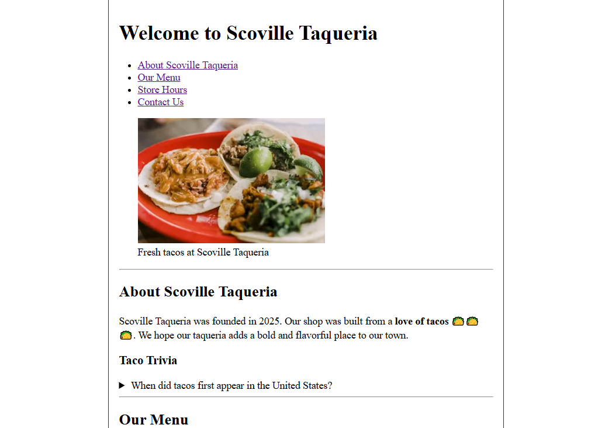

# Scoville Taqueria Website

## Description

Scoville Taqueria is a simple three-page restaurant website that presents the brand, store hours, menu highlights, and a contact form for customers.

## Tech Stack

- HTML
- CSS

## Features for Scoville Taqueria Website

- Main navigation area
- Store Hours
- Menu highlights
- Contact form

## Screenshots

The screenshots for all the web pages are in the `screenshots/` folder where the 3 pages can be quickly previewed. The filenames for the screenshots of the 3 pages are `home-screenshot.png`, `hours-screenshot.png`, and `contact-screenshot.png`.

## Project Structure

- `index.html` for the homepage
- `hours.html` for store hours
- `contact.html` for the contact form and location details

## Notes

The project includes minimal CSS file for the basic styling of the site. This is an HTML-based project with a clear focus on structure and semantics of the Website.
